# Safety-First Multi-Asset

**Allocation tactique sur 8 ETF : prévision ARIMA-XGBoost, volatilité GARCH, optimisation de Markowitz sous filtre de tendance. Backtest walk-forward intégral, net de frais, de février 2011 à octobre 2026.**

Antonin Meudic · [LinkedIn](https://www.linkedin.com/in/antonin-meudic/)

  

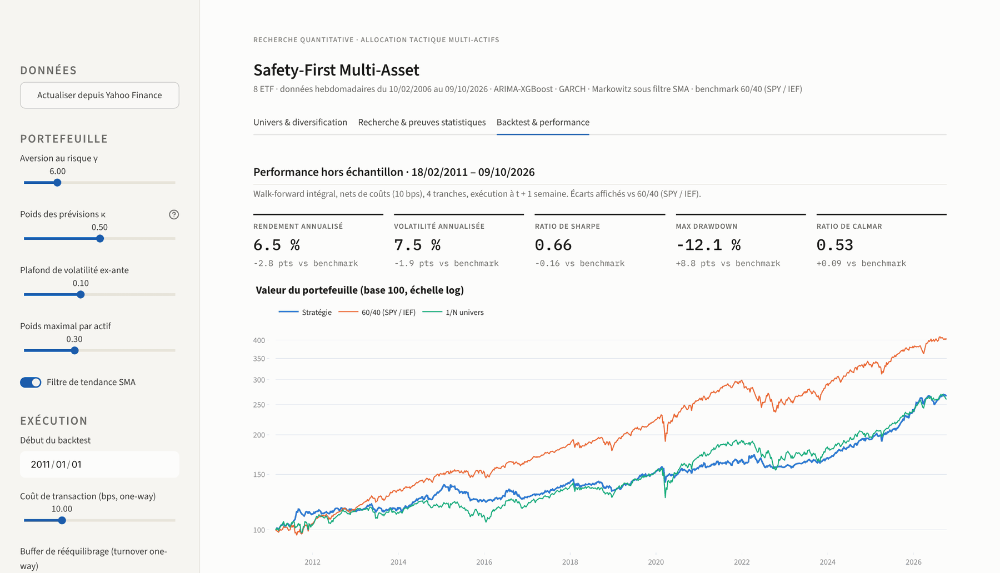

---

## En bref

Ce projet construit une stratégie d'allocation multi-actifs long-only et la soumet aux tests qu'un comité d'investissement exigerait : walk-forward strict, coûts de transaction, exécution décalée, benchmark investissable, ablation de chaque composante, balayage de 1 000 jeux de paramètres et intervalles de confiance.

| 18/02/2011 – 09/10/2026, net de 10 bps | Stratégie | 60/40 (SPY / IEF) | 1/N (8 ETF) |
|---|---:|---:|---:|
| Rendement annualisé | 6,5 % | **9,3 %** | 6,3 % |
| Volatilité annualisée | **7,5 %** | 9,5 % | 9,9 % |
| Ratio de Sharpe | 0,66 | **0,83** | 0,51 |
| Drawdown maximal | **−12,1 %** | −20,9 % | −19,8 % |
| Ratio de Calmar | **0,53** | 0,45 | 0,32 |
| Perte en 2022 | **−5,7 %** | −16,6 % | −13,6 % |

**Ce qu'il faut retenir**

1. **La stratégie ne bat pas le 60/40 en rendement ajusté du risque sur 2011-2026.** Aucune des 1 000 configurations testées n'y parvient. La période est la plus favorable de l'histoire récente au 60/40 : marché actions américain exceptionnel et corrélation actions / obligations négative jusqu'en 2021.
2. **Elle tient sa promesse de protection.** Drawdown maximal réduit de 42 %, pertes divisées par deux à trois pendant le Covid et en 2022. 95 % des configurations testées ont un drawdown inférieur à celui du 60/40 : ce résultat ne dépend pas d'un réglage chanceux.
3. **La protection vient de la gestion du risque, pas des prévisions.** Les prévisions de rendement ARIMA-XGBoost n'ont pas de pouvoir prédictif hors échantillon démontrable (R² ≈ 0, coefficient d'information légèrement négatif). Le filtre de tendance et le budget de volatilité expliquent l'essentiel du profil.
4. **Le résultat dépend du régime de marché.** Sur une fenêtre démarrant en 2018 ou après, la stratégie égale ou dépasse le 60/40 en Sharpe (0,83 contre 0,33 depuis 2022).

Le projet est conçu pour pouvoir réfuter ses propres briques : le README présente les résultats défavorables avec la même visibilité que les autres.

---

## Sommaire

1. [Question de recherche](#1-question-de-recherche)
2. [Architecture](#2-architecture)
3. [Univers d'investissement et benchmarks](#3-univers-dinvestissement-et-benchmarks)
4. [Méthodologie, brique par brique](#4-méthodologie-brique-par-brique)
5. [Résultats de la configuration de référence](#5-résultats-de-la-configuration-de-référence)
6. [D'où vient la performance ? Ablation et qualité des prévisions](#6-doù-vient-la-performance--ablation-et-qualité-des-prévisions)
7. [Analyse de sensibilité : 1 054 backtests](#7-analyse-de-sensibilité--1-054-backtests)
8. [Robustesse statistique](#8-robustesse-statistique)
9. [Enseignements pour la gestion quantitative](#9-enseignements-pour-la-gestion-quantitative)
10. [Limites et pistes](#10-limites-et-pistes)
11. [Reproduire les résultats](#11-reproduire-les-résultats)
12. [Glossaire](#12-glossaire)
13. [Références](#13-références)

---

## 1. Question de recherche

> Un investisseur diversifié peut-il réduire ses pertes extrêmes sans sacrifier son rendement ajusté du risque, en combinant des prévisions statistiques, un modèle de volatilité et une règle de tendance dans un optimiseur de portefeuille ?

La philosophie est **Safety-First** (Roy, 1952) : contrôler la probabilité et l'ampleur des pertes passe avant la maximisation du rendement. Concrètement :

- **long-only, sans levier** : la partie non investie est placée en T-Bills ;
- **budget de volatilité ex-ante** : la volatilité prévue du portefeuille ne dépasse jamais 10 % par an ;
- **sortie progressive des actifs en tendance baissière** ;
- **coûts de transaction intégrés à la décision**, pas seulement à la comptabilité.

Le livrable est double : une pipeline de recherche reproductible (`src/`, `scripts/`) et une application Streamlit qui expose chaque étape avec ses tests statistiques.

---

## 2. Architecture

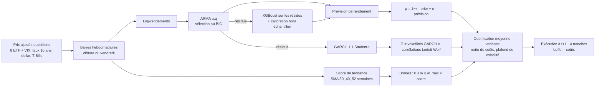

**Calendrier walk-forward.** À chaque semaine *t*, tous les modèles sont estimés sur les 260 semaines précédentes (5 ans) et uniquement sur elles. Aucune donnée postérieure à *t* n'entre dans une décision prise en *t*.

| Étape | Fréquence de ré-estimation |
|---|---|
| Ordre ARMA (p, q) | toutes les 52 semaines |
| Paramètres ARMA et GARCH | chaque semaine |
| XGBoost et sa calibration | toutes les 4 semaines |
| Optimisation du portefeuille | toutes les 4 semaines, par tranche |

Les premières données datent de février 2006 (lancement de DBC). Il faut 5 ans d'historique pour la première estimation : le backtest commence donc en **février 2011**.

---

## 3. Univers d'investissement et benchmarks

| Ticker | Exposition | Classe | Rôle |
|---|---|---|---|
| SPY | S&P 500 | Actions | Prime de risque actions US |
| EFA | MSCI EAFE | Actions | Actions développées hors US |
| EEM | MSCI Emerging Markets | Actions | Actions émergentes |
| IEF | Treasuries 7-10 ans | Taux | Duration intermédiaire, amortisseur |
| TLT | Treasuries 20+ ans | Taux | Duration longue, couverture déflationniste |
| GLD | Or | Réels | Couverture monétaire et de risque extrême |
| DBC | Matières premières | Réels | Couverture inflation |
| VNQ | REITs US | Réels | Prime immobilière |

**Pourquoi ces actifs.** Chaque ETF représente une prime de risque distincte. L'ossature reprend l'allocation tactique de Faber (2007), complétée par les émergents, la duration longue et l'or. QQQ (corrélation de 0,9 avec SPY) et LQD (redondant avec IEF) ont été écartés : des actifs quasi identiques dégradent le conditionnement de la matrice de covariance et rendent l'optimiseur instable.

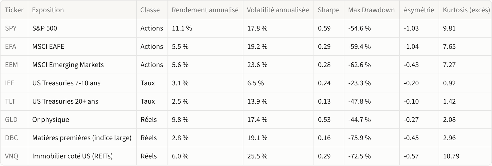

**Lecture.** Sur 2006-2026, aucun actif n'a de rendements hebdomadaires gaussiens (Jarque-Bera p < 0,001 partout). L'excès de kurtosis atteint 9,8 sur SPY et 10,8 sur VNQ : les pertes extrêmes sont beaucoup plus fréquentes que ne le prévoit une loi normale. Les drawdowns individuels vont de −23 % (IEF) à −76 % (DBC). Aucun actif isolé n'est compatible avec une philosophie Safety-First, d'où l'intérêt de la diversification et du contrôle dynamique du risque.

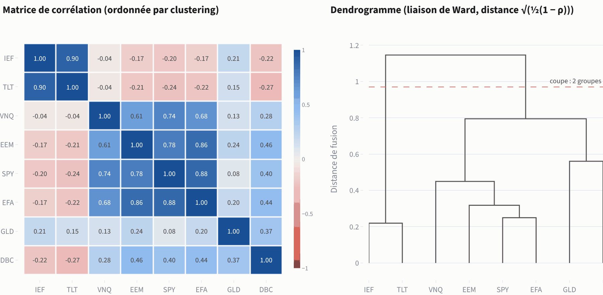

**Diversification mesurée.** Le clustering hiérarchique (distance √(½(1−ρ)), liaison de Ward) identifie deux blocs : les Treasuries (IEF, TLT, corrélation 0,90) et les actifs risqués. La corrélation moyenne est de 0,24 et le *nombre effectif de paris* de 4,4 sur 8 : l'univers contient environ quatre sources de risque réellement indépendantes. La première composante principale explique 47 % de la variance, c'est le facteur « risque global ».

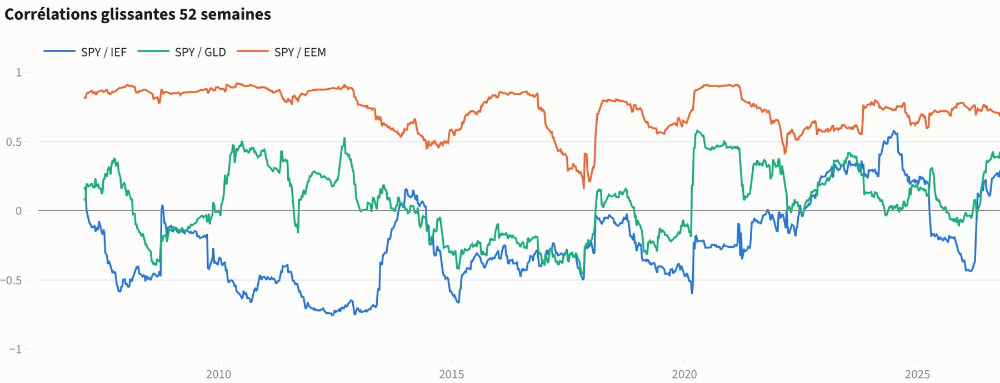

**Point clé pour la suite.** La corrélation SPY / IEF, négative pendant la majeure partie de 2011-2021, est devenue positive en 2022. Les obligations ont cessé de protéger les actions au moment où on en avait le plus besoin. C'est le scénario contre lequel le filtre de tendance et la poche de liquidité sont conçus.

### Benchmarks

| Benchmark | Pourquoi |
|---|---|
| **60/40 SPY / IEF** (principal) | Portefeuille de référence d'un investisseur diversifié. Long-only, investissable, sans paramètre estimé, même calendrier de rééquilibrage et mêmes coûts que la stratégie. |
| **1/N sur les 8 ETF** (secondaire) | DeMiguel, Garlappi & Uppal (2009) montrent que la pondération naïve bat la plupart des optimiseurs hors échantillon. La battre à univers identique isole la valeur ajoutée de la modélisation. |

Les deux sont calculés en rendement total (dividendes réinvestis). Comparer des ETF en rendement total à un indice de prix comme `^GSPC` gonflerait artificiellement l'écart de 1,5 à 2 points par an.

---

## 4. Méthodologie, brique par brique

Chaque section suit la même structure : ce que fait la brique, pourquoi ce choix, et ce que les données en disent. Les captures sont tirées de l'onglet « Recherche & preuves statistiques » de l'application, sur SPY, avec une coupure apprentissage / test en juillet 2020.

### 4.1 Données et calendrier

- Clôtures quotidiennes **ajustées** (dividendes et splits), agrégées en barres hebdomadaires du vendredi. La semaine en cours, incomplète, est exclue.
- Fréquence hebdomadaire : moins de bruit de microstructure et pas de décalage de fuseaux horaires entre marchés, tout en conservant environ 1 000 observations.
- Taux sans risque : T-Bills 13 semaines (`^IRX`, 1,6 % par an en moyenne sur la période). Il rémunère la poche de liquidité et sert de référence au Sharpe.
- VIX, taux 10 ans et dollar index servent uniquement de variables explicatives.

### 4.2 ARIMA : la composante linéaire

**Ce que fait la brique.** Elle prévoit le rendement des 4 semaines suivantes à partir des rendements passés, avec un modèle ARMA(p, q) sur les log-rendements.

**Choix de l'ordre.** Les tests ADF (H0 : racine unitaire) et KPSS (H0 : stationnarité) concluent tous deux que le log-prix est non stationnaire et que ses variations le sont (d = 1). L'ordre (p, q) est choisi sur une grille {0..3}² au critère **BIC**.

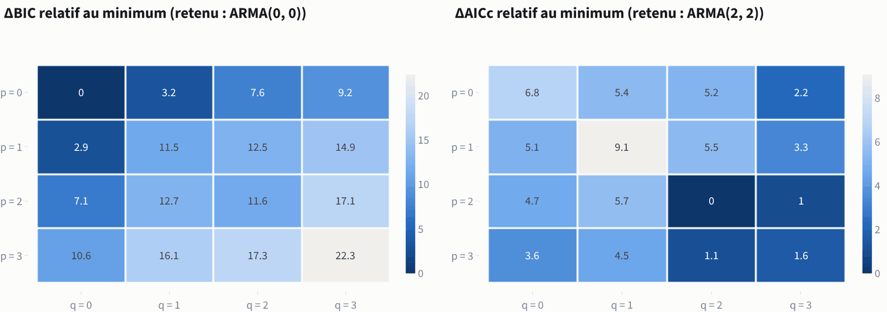

Sur SPY, le BIC retient **ARMA(0, 0)** : le meilleur prédicteur linéaire est la moyenne. L'AICc, moins pénalisant, retient ARMA(2, 2), un modèle dont les racines se compensent presque et qui produit des prévisions instables. Sur l'ensemble des ré-estimations annuelles, ARMA(0, 0) est retenu de 62 % (VNQ) à 100 % (SPY, EEM, EFA) du temps.

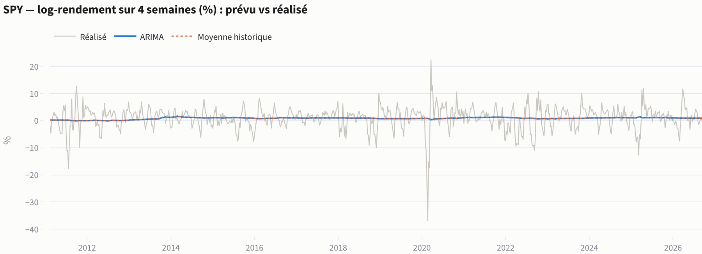

> **En clair.** La ligne bleue (prévision) est presque plate pendant que la ligne grise (réalisé) oscille entre −35 % et +20 %. À l'horizon d'un mois, le passé linéaire des prix ne dit presque rien du futur. C'est le résultat attendu sur des marchés liquides (efficience faible), et il est assumé : ARIMA sert ici à estimer proprement la dérive locale et à produire des résidus pour les briques suivantes.

**Diagnostics des résidus.** Ljung-Box rejette l'absence d'autocorrélation aux retards 4 à 12 (p entre 0,006 et 0,018) : il subsiste une faible dépendance, mais trop faible pour être exploitée. ARCH-LM (p < 0,001) détecte une forte hétéroscédasticité conditionnelle, ce qui justifie le GARCH. Jarque-Bera (p < 0,001) confirme les queues épaisses, ce qui justifie des innovations Student-t.

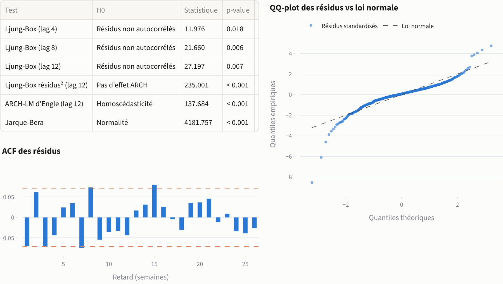

### 4.3 XGBoost sur les résidus : la composante non linéaire

**Ce que fait la brique.** Elle apprend la partie des rendements futurs que l'ARIMA n'explique pas (Zhang, 2003) :

$$\hat r_{t\to t+4} = \underbrace{\textstyle\sum_{k=1}^{4}\hat r^{\,\mathrm{ARIMA}}_{t+k|t}}_{\text{linéaire}} + \underbrace{\beta \cdot f_{\mathrm{XGB}}(X_t)}_{\text{correction non linéaire}}$$

**15 variables causales et stationnaires** : momentum 1, 4, 12 et 26 semaines, distance à la moyenne mobile 40 semaines, drawdown 52 semaines, volatilité réalisée et choc de volatilité, RSI, %B de Bollinger, MACD normalisé, variation et z-score du VIX, variation du taux 10 ans et du dollar. Les niveaux bruts (prix, niveau du VIX) sont exclus : leur distribution dérive dans le temps.

**Garde-fous contre le sur-apprentissage.** Avec 260 observations hebdomadaires qui se chevauchent sur 4 semaines, chaque fenêtre ne contient qu'environ 60 observations indépendantes. D'où :

- des hyper-paramètres fixés a priori et très conservateurs : profondeur 2, learning rate 0,01, `min_child_weight` 40, régularisation L2 = 20, ensemble de 3 graines ;
- seuls les échantillons dont la cible est entièrement observée à la date de décision sont utilisés ;
- une **calibration hors échantillon** : à chaque ré-entraînement, une validation croisée par blocs purgés (embargo de 4 semaines, López de Prado 2018) estime un coefficient β ∈ [0, 1]. Si le modèle n'a pas de pouvoir prédictif hors échantillon, β tend vers 0 et la correction s'éteint d'elle-même.

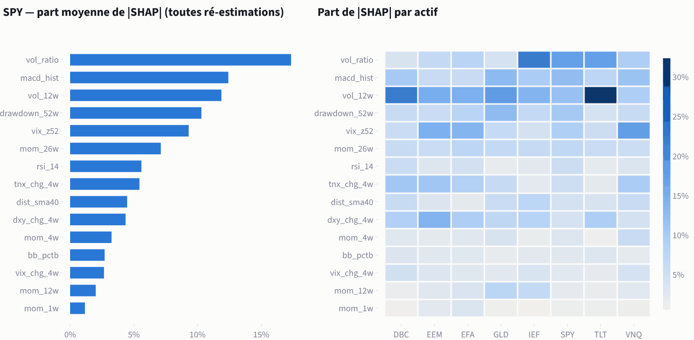

**Ce que montrent les données.** Les variables de volatilité et de stress (choc de volatilité, volatilité 12 semaines, z-score du VIX) dominent l'importance SHAP sur tous les actifs. Mais l'importance SHAP mesure l'usage qu'un modèle fait d'une variable, pas sa valeur prédictive. Le test décisif est la validation hors échantillon :

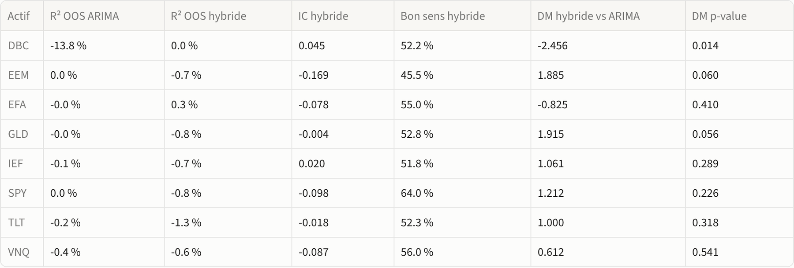

- Le R² hors échantillon du modèle hybride est compris entre −1,3 % et +0,3 % selon l'actif : il ne fait pas mieux que la moyenne historique.
- Le test de Diebold-Mariano ne montre une amélioration significative par rapport à l'ARIMA que sur DBC, et uniquement parce que l'ARIMA de DBC a sélectionné un ARMA(3, 2) instable pendant un an (prévisions jusqu'à +4,9 % par mois en 2021).
- **La valeur médiane de β est 0 pour les 8 actifs** : la calibration a désactivé la correction XGBoost la plupart du temps. Le garde-fou a fonctionné comme prévu.

> **En clair.** Le machine learning n'a pas trouvé de signal exploitable dans ces données à cet horizon, et le dispositif de calibration l'a reconnu automatiquement au lieu d'injecter du bruit dans le portefeuille. Un modèle qui sait se taire vaut mieux qu'un modèle sur-ajusté qui affiche un excellent backtest.

### 4.4 GARCH : la volatilité conditionnelle

**Ce que fait la brique.** Elle prévoit le risque de chaque actif sur les 4 semaines suivantes. La volatilité n'est pas constante : elle se regroupe en périodes de calme et de stress, et GARCH(1,1) capture cette persistance.

$$e_t=\sigma_t z_t,\quad z_t\sim t_\nu,\qquad \sigma_t^2=\omega+\alpha\,e_{t-1}^2+\beta\,\sigma_{t-1}^2$$

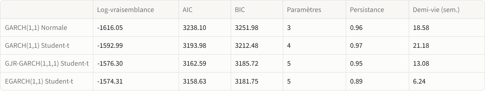

**Choix de spécification.** Sur SPY, l'EGARCH Student-t a le meilleur BIC, car l'asymétrie (les baisses augmentent plus la volatilité que les hausses) est significative sur les actions. La pipeline utilise pourtant GARCH(1,1)-t pour tous les actifs : c'est le modèle le plus parcimonieux, robuste à une ré-estimation hebdomadaire sur 5 ans, et l'asymétrie n'apporte qu'un gain marginal hors des actions. Sur l'échantillon d'apprentissage SPY : α = 0,24, β = 0,72, ν = 6 degrés de liberté, persistance 0,97, demi-vie d'un choc de 21 semaines.

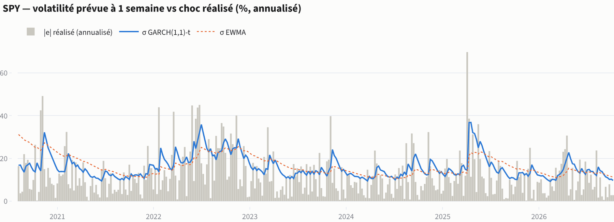

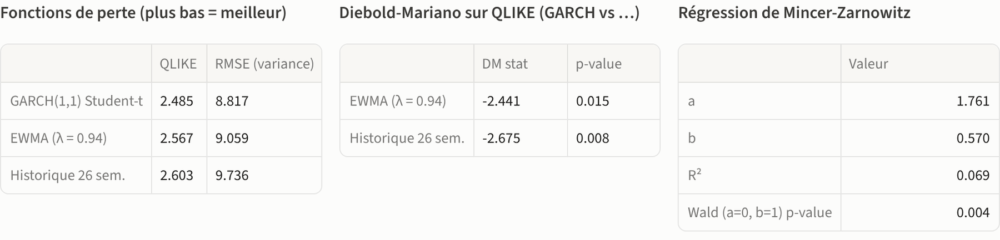

**Évaluation hors échantillon** (323 semaines, paramètres gelés) :

- GARCH bat significativement EWMA (RiskMetrics) et la volatilité historique sur la perte QLIKE (Diebold-Mariano, p = 0,015 et 0,008) ;
- la régression de Mincer-Zarnowitz donne une pente de 0,57 (Wald p = 0,004) : les prévisions sont informatives mais réagissent trop aux chocs. Le R² de 7 % est normal avec un proxy aussi bruité que le rendement au carré.

> **En clair.** Contrairement aux rendements, le risque est prévisible. C'est la brique dont la valeur est la mieux établie statistiquement, et c'est elle qui permet de tenir un budget de volatilité.

### 4.5 Filtre de tendance

**Ce que fait la brique.** Elle borne le poids de chaque actif selon sa tendance de long terme :

$$s_{i,t}=\tfrac{1}{3}\textstyle\sum_{L\in\{30,40,52\}}\mathbf 1\{P_{i,t}>\mathrm{SMA}_L(P_i)_t\},\qquad 0\le w_{i,t}\le w_{\max}\, s_{i,t}$$

La SMA 40 semaines correspond à la règle 10 mois / 200 jours de Faber (2007). Moyenner trois horizons réduit la dépendance à un paramètre unique et les allers-retours. Le filtre est une **contrainte, pas une prévision** : il n'oblige jamais à acheter, il retire progressivement un actif de l'ensemble admissible.

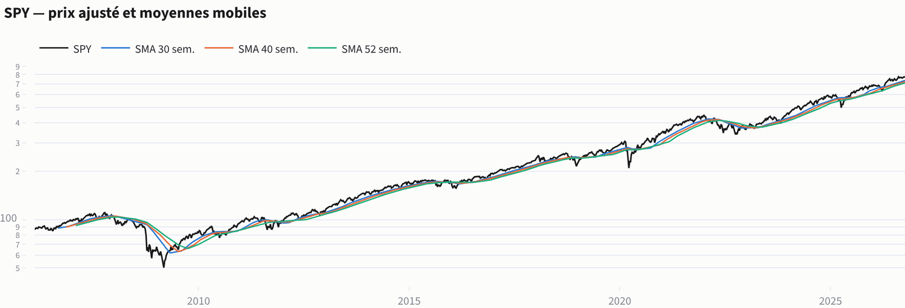

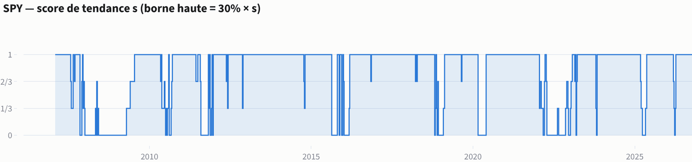

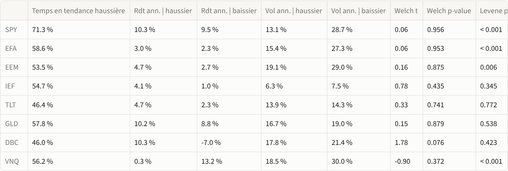

**Ce que montrent les données (2006-2026, rendements à 4 semaines non chevauchants).**

- **Le filtre ne prédit pas le rendement.** Le test de Welch ne rejette l'égalité des rendements moyens sur aucun actif (p entre 0,08 et 0,96). Sur VNQ, les phases baissières ont même eu un meilleur rendement moyen.
- **Il identifie les régimes de volatilité.** La volatilité de SPY passe de 13 % en tendance haussière à 29 % en tendance baissière, celle d'EFA de 15 % à 27 %. Le test de Levene rejette l'égalité des variances pour SPY, EFA, EEM et VNQ (p < 0,01).

> **En clair.** La moyenne mobile ne dit pas si un actif va monter. Elle dit dans quel climat on se trouve. Quand un marché actions passe sous ses moyennes de long terme, son risque double. Réduire l'exposition dans ces phases améliore le rapport entre le rendement obtenu et les pertes subies, ce qui est exactement l'objectif Safety-First. C'est cohérent avec Hurst, Ooi & Pedersen (2017).

### 4.6 Optimisation de Markowitz

$$\max_w\; w^\top(\mu-r_f\mathbf 1)-\tfrac{\gamma}{2}w^\top\Sigma w-c\,\|w-w^0\|_1\quad\text{s.c.}\quad 0\le w_i\le w_{\max}s_i,\;\mathbf 1^\top w\le 1,\;\sqrt{\tfrac{52}{4}w^\top\Sigma w}\le\sigma_{\text{cap}}$$

| Élément | Choix | Raison |
|---|---|---|
| Objectif | Utilité moyenne-variance, aversion γ = 6 | Avec un actif sans risque, le Sharpe est invariant d'échelle : il fixe la direction du portefeuille, pas le montant investi. L'utilité fixe les deux. |
| Rendements espérés | μ = (1−κ) · prior + κ · prévision, κ = 0,5 | Rétrécissement vers un prior d'équilibre « Sharpe constant » (r_f + 0,3·σ), dans l'esprit de Black-Litterman. Avec κ = 0, l'allocation ne dépend que du risque. |
| Covariance | Σ = D · R · D | D : volatilités GARCH prévues. R : corrélations sur 2 ans rétrécies par Ledoit-Wolf, ce qui garantit une matrice bien conditionnée. |
| Contraintes | Long-only, Σw ≤ 1, w_max = 30 % × score de tendance, volatilité ≤ 10 % | Le reliquat est investi en T-Bills. |
| Coûts | 10 bps par unité échangée, dans l'objectif | Une réallocation n'a lieu que si son gain d'utilité dépasse son coût. |

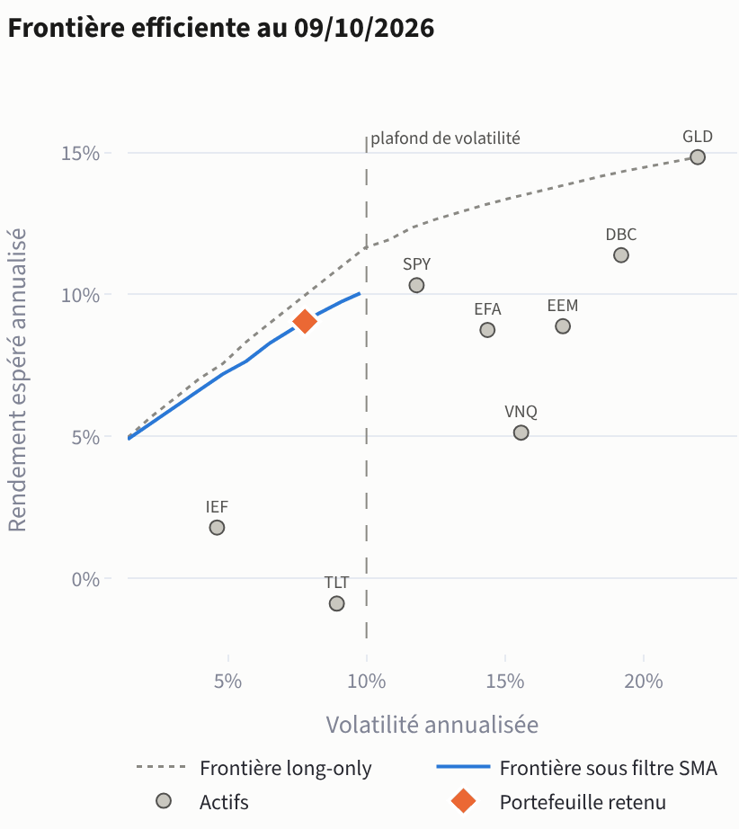

**Lecture de la frontière.** En pointillés, la frontière long-only sans contrainte de tendance ; en bleu, la frontière réellement accessible une fois les actifs en tendance baissière exclus (IEF, TLT, GLD et VNQ au 9 octobre 2026). Le portefeuille retenu (losange) se situe sous le plafond de volatilité de 10 % : l'aversion au risque, et non le plafond, détermine le niveau de risque dans la configuration de référence.

> **Pourquoi un prior plutôt que les prévisions brutes ?** Un optimiseur non contraint est un « maximiseur d'erreurs d'estimation » (Michaud, 1989) : il surpondère les actifs dont le rendement est le plus surestimé. Rétrécir les prévisions vers un prior neutre limite ce biais. Les résultats de la section 4.3 montrent que cette prudence était justifiée.

### 4.7 Exécution

- **Signal à la clôture de la semaine s, exécution à la clôture de s + 1.** Aucun ordre n'est passé au prix qui a servi à le calculer.
- **Rééquilibrage toutes les 4 semaines**, aligné sur l'horizon de prévision.
- **Tranching** : le capital est réparti en 4 sous-portefeuilles qui se rééquilibrent à tour de rôle, une tranche par semaine. Le résultat ne dépend plus du jour arbitraire de rééquilibrage (*rebalance timing luck*, Hoffstein, Faber & Braun 2020).
- **Buffer** : une tranche ne traite pas si le turnover proposé est inférieur à 5 %, sauf pour réduire une position qui dépasse sa nouvelle borne de tendance. Les sorties de risque ne sont jamais différées.
- **Comptabilité** en rendements simples, dérive des poids entre deux rééquilibrages, cash rémunéré au taux des T-Bills.

---

## 5. Résultats de la configuration de référence

Paramètres : γ = 6, κ = 0,5, plafond de volatilité 10 %, poids maximal 30 %, filtre de tendance actif, coûts 10 bps, buffer 5 %, 4 tranches. Ces valeurs ont été fixées avant l'analyse de sensibilité de la section 7 et n'ont pas été modifiées depuis.

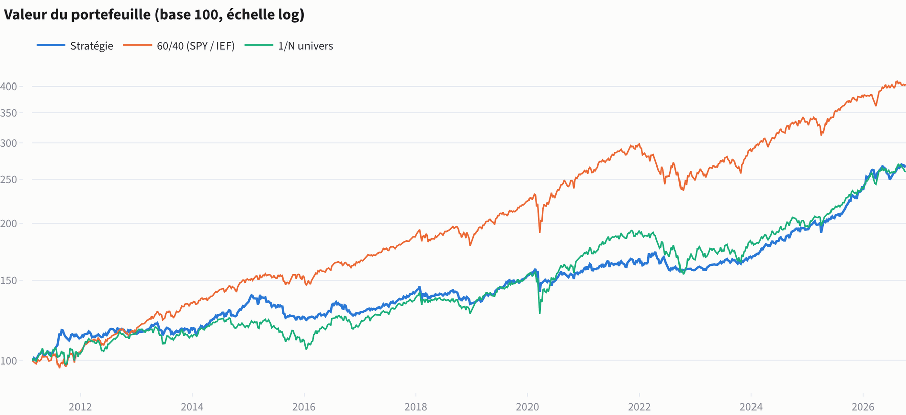

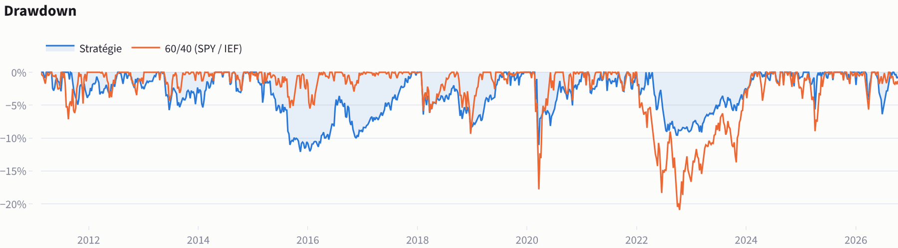

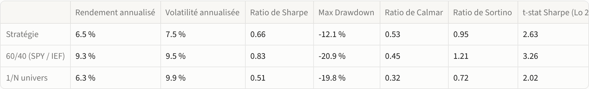

**Lecture.** Sur 15,6 ans, la stratégie a capté 6,5 % par an avec 7,5 % de volatilité. Le 60/40 a fait mieux en rendement (9,3 %) et en Sharpe (0,83 contre 0,66), mais au prix d'un drawdown presque deux fois plus profond (−20,9 % contre −12,1 %). Le bêta par rapport au 60/40 est de 0,45 et la corrélation de 0,57 : la stratégie est un profil de risque différent, pas un 60/40 déguisé.

**À risque égal.** Un 60/40 ramené à la volatilité de la stratégie (80 % investi, 20 % en T-Bills) aurait rapporté 7,8 % par an avec un drawdown de −16,7 %. La stratégie rend donc environ 1,3 point de rendement annuel contre 4,6 points de drawdown en moins.

### Par sous-période

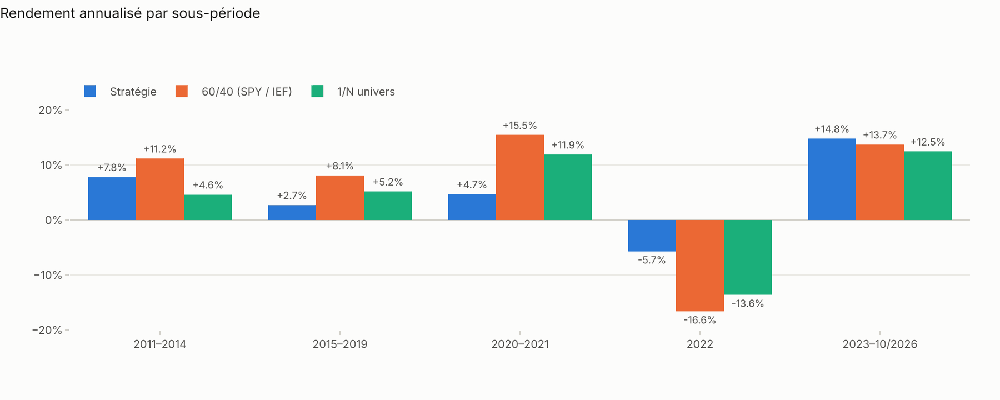

| Période | Stratégie (Sharpe) | 60/40 (Sharpe) | Contexte |
|---|---:|---:|---|
| 2011-2014 | 1,18 | 1,44 | Reprise post-crise, taux zéro |
| 2015-2019 | 0,28 | 0,97 | Marchés sans tendance, nombreux faux signaux |
| 2020-2021 | 0,48 | 1,11 | Krach éclair puis rebond en V |
| 2022 | −0,87 | −1,25 | Inflation, hausse des taux, actions et obligations baissent ensemble |
| 2023-10/2026 | **1,32** | 0,99 | Tendances marquées sur actions, or et matières premières |

La stratégie sous-performe nettement en 2015-2019 et 2020-2021. Ce sont deux régimes défavorables à un filtre de tendance : des marchés sans direction qui multiplient les signaux contradictoires, puis un krach et un rebond trop rapides pour des moyennes mobiles de 7 à 12 mois. Elle surperforme quand une tendance s'installe, à la baisse comme à la hausse.

### Épisodes de stress

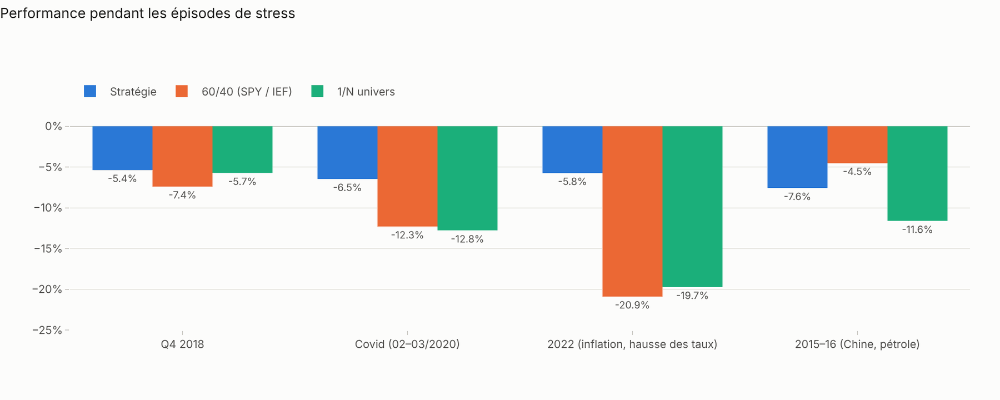

La protection est nette en 2022 (−5,8 % contre −20,9 %) et pendant le Covid (−6,5 % contre −12,3 %). Elle est absente en 2015-2016 (−7,6 % contre −4,5 %) : la chute du pétrole et des émergents s'est faite en plusieurs vagues, et le filtre est sorti puis rentré à contretemps. Le drawdown maximal de la stratégie date de novembre 2015, et sa plus longue période sous un précédent sommet a duré 139 semaines (2015-2018), contre 111 pour le 60/40.

Sur les 80 semaines où SPY était à plus de 10 % sous son plus haut annuel, la stratégie a perdu 9,2 % en rythme annualisé, contre 16,6 % pour le 60/40 et 21,9 % pour le 1/N. Sur des périodes de 4 semaines, elle capte 62 % des hausses du 60/40 et 53 % de ses baisses.

### Allocation dans le temps

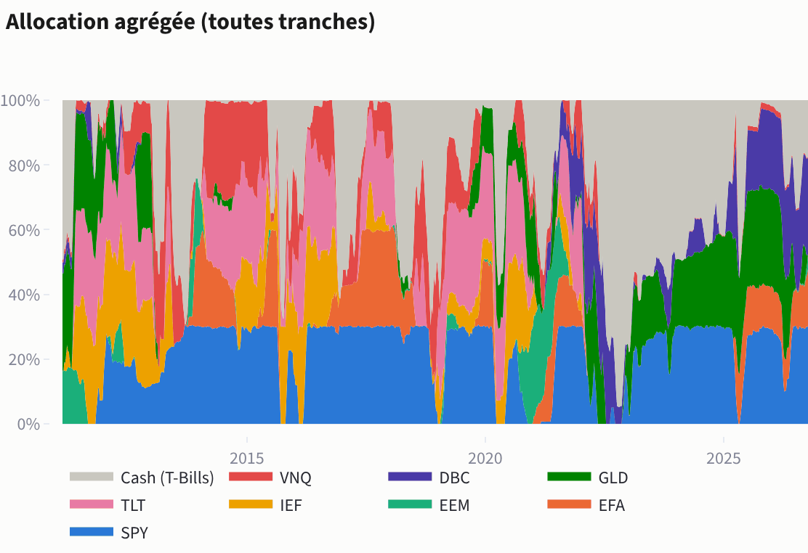

| Poids moyen | SPY | TLT | GLD | VNQ | IEF | EFA | DBC | EEM | T-Bills |
|---|---|---|---|---|---|---|---|---|---|
| 2011-2026 | 21 % | 12 % | 10 % | 9 % | 8 % | 6 % | 5 % | 3 % | 25 % |

L'allocation est réellement dynamique. La poche de T-Bills dépasse 50 % dans 18 % des semaines, notamment en 2022 et 2023 (56 % et 55 % en moyenne annuelle), quand actions et obligations étaient simultanément en tendance baissière. Les obligations disparaissent du portefeuille à partir de 2022, remplacées par l'or puis les matières premières en 2025-2026.

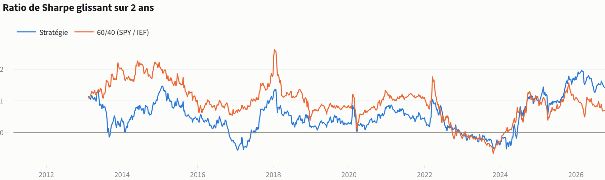

### Coûts et rotation

| Turnover annuel (one-way) | Coûts annuels | Rééquilibrages exécutés | Évités par le buffer |
|---:|---:|---:|---:|
| 129 % | 0,26 % | 526 | 294 (36 %) |

Un turnover de 129 % par an est élevé pour une allocation d'actifs. À 10 bps, il coûte 0,26 % par an. La section 7 montre à partir de quel niveau de coût la stratégie perd son intérêt.

---

## 6. D'où vient la performance ? Ablation et qualité des prévisions

L'ablation retire une seule brique à la fois, toutes choses égales par ailleurs (même période, mêmes coûts, même tranching).

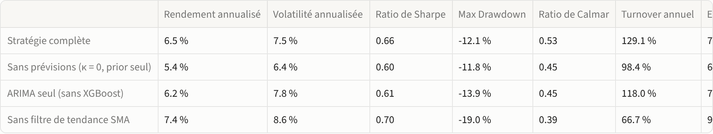

| Variante | Sharpe | Drawdown max | Calmar | Lecture |
|---|---:|---:|---:|---|
| Stratégie complète | 0,66 | −12,1 % | 0,53 | Référence |
| Sans prévisions (κ = 0) | 0,60 | −11,8 % | 0,45 | Les prévisions ajoutent +0,06 de Sharpe et du turnover |
| ARIMA seul (sans XGBoost) | 0,61 | −13,9 % | 0,45 | XGBoost ajoute +0,05 de Sharpe |
| Moyenne historique à la place des prévisions | 0,60 | −13,8 % | 0,44 | Les prévisions font à peine mieux qu'une moyenne |
| Sans filtre de tendance | **0,70** | −19,0 % | 0,39 | Sharpe un peu meilleur, drawdown bien pire |

**Interprétation.**

- **Le filtre de tendance est la brique Safety-First par excellence.** Sans lui, le Sharpe est légèrement supérieur, mais le drawdown passe de −12 % à −19 % et le Calmar chute de 0,53 à 0,39. Il échange un peu de rendement contre beaucoup de protection.
- **Les prévisions apportent un gain faible et fragile.** +0,06 de Sharpe, c'est moins que l'écart entre deux tranches qui ne diffèrent que par leur semaine de rééquilibrage (0,23, section 8). Ce gain est cohérent avec l'absence de pouvoir prédictif mesurée en 4.3 : il ne peut pas être distingué du bruit.
- **Le prior seul (κ = 0) fait déjà presque tout le travail.** Un portefeuille fondé uniquement sur le risque (proche de la parité de risque) sous filtre de tendance et budget de volatilité atteint un Sharpe de 0,60, supérieur au 1/N (0,51).

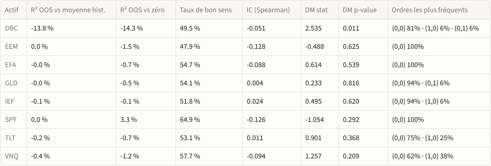

**Qualité des prévisions, moyenne sur 8 actifs :**

| Modèle | R² hors échantillon vs moyenne historique | Coefficient d'information | Taux de bon sens |
|---|---:|---:|---:|
| ARIMA | −1,8 % | −0,056 | 54,2 % |
| ARIMA + XGBoost | −0,6 % | −0,049 | 53,7 % |
| Moyenne historique | 0 % (référence) | −0,049 | 54,8 % |

Ces chiffres sont dans la norme de la littérature : Welch & Goyal (2008) montrent que la quasi-totalité des prédicteurs de la prime de risque ont un R² hors échantillon négatif. Le résultat honnête de ce projet est que la prévision de rendement, même avec du machine learning soigneusement régularisé, ne produit pas d'alpha exploitable à l'horizon mensuel sur ces actifs.

---

## 7. Analyse de sensibilité : 1 054 backtests

Les signaux ne dépendent pas des paramètres de portefeuille : ils sont calculés une fois, puis seuls l'optimisation et le backtest sont rejoués. Deux études, reproductibles avec `python -m scripts.parameter_sweep` (résultats complets dans [`docs/results/parameter_sweep.csv`](docs/results/parameter_sweep.csv)) :

- **54 backtests « un paramètre à la fois »** autour de la configuration de référence ;
- **une grille factorielle complète de 1 000 backtests** : γ ∈ {2, 4, 6, 10, 20} × κ ∈ {0 ; 0,25 ; 0,5 ; 0,75 ; 1} × plafond de volatilité ∈ {6, 8, 10, 12, 15 %} × poids maximal ∈ {20, 30, 45, 60 %} × filtre de tendance {oui, non}.

### Vue d'ensemble

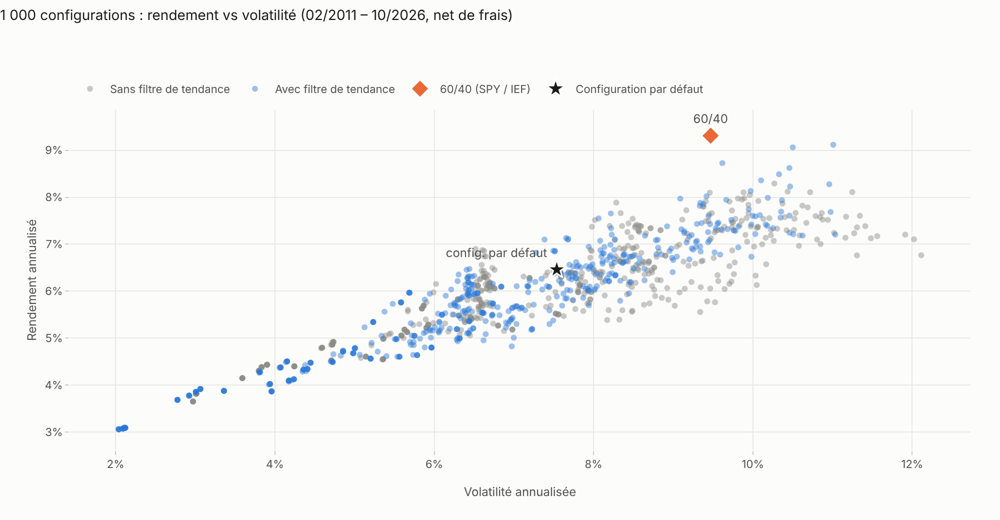

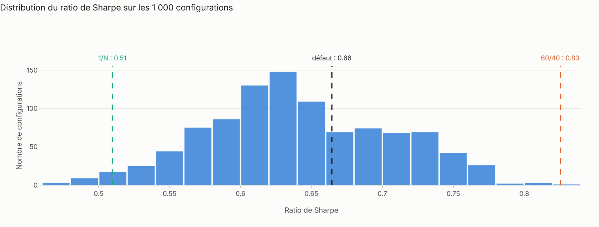

| Sur les 1 000 configurations | Résultat |
|---|---|
| Sharpe médian (intervalle interquartile) | 0,64 (0,60 – 0,69) |
| Sharpe minimal / maximal | 0,46 / 0,82 |
| Part avec un Sharpe supérieur au 60/40 (0,83) | **0 %** |
| Part avec un Sharpe supérieur au 1/N (0,51) | 98 % |
| Part avec un drawdown inférieur à celui du 60/40 | **95 %** |
| Part avec un Calmar supérieur à celui du 60/40 | 49 % |

**Lecture.** Le nuage forme une bande serrée : le rapport rendement / risque est remarquablement stable, quels que soient les réglages. Les paramètres déplacent surtout la stratégie le long de cette bande (plus ou moins de risque), sans la faire sortir de la zone « Sharpe 0,6-0,7, drawdown −10 à −17 % ». C'est un signe de robustesse, et en même temps le constat qu'aucun réglage ne fait apparaître d'alpha face au 60/40. La configuration de référence fait mieux que deux tiers des configurations de la grille, sans être la meilleure : elle a été fixée avant le balayage.

### Paramètre par paramètre

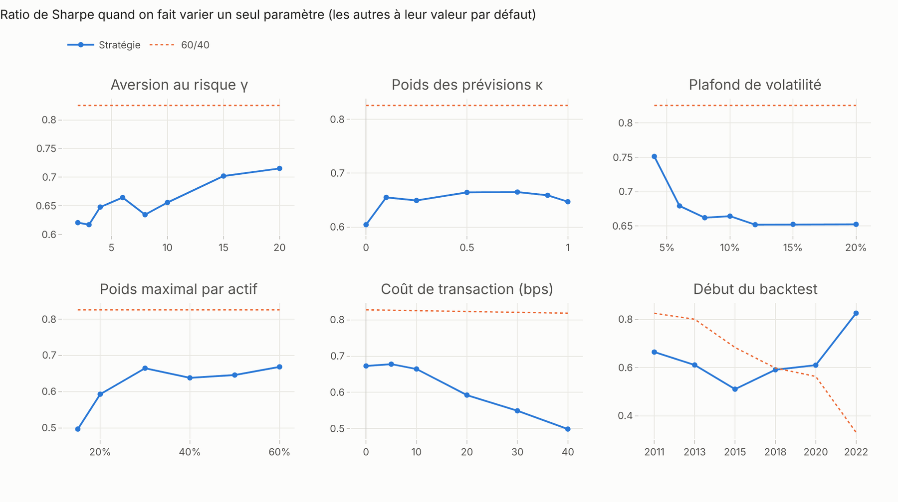

**Aversion au risque γ.** Plus γ est élevé, plus la stratégie détient de T-Bills (exposition moyenne de 86 % à γ = 2, 46 % à γ = 20) et plus son Sharpe monte (0,61 à 0,69 en moyenne sur la grille). Mélanger un portefeuille risqué avec du cash ne change pas son Sharpe : si le Sharpe progresse, c'est que les positions supplémentaires prises à faible γ ont un rendement ajusté du risque inférieur au reste. Autrement dit, quand l'optimiseur est autorisé à parier davantage, ses paris additionnels sont de mauvaise qualité. C'est le symptôme classique d'espérances de rendement bruitées.

**Poids des prévisions κ.** La relation a une forme en cloche : Sharpe moyen de 0,63 à κ = 0, maximum de 0,69 à κ = 0,25, puis 0,60 à κ = 1. Un peu de signal aide, beaucoup de signal ajoute surtout du turnover (49 % par an à κ = 0 contre 136 % à κ = 1). C'est ce que prédit la loi fondamentale de Grinold & Kahn : avec un coefficient d'information proche de zéro, le poids optimal accordé aux prévisions est faible.

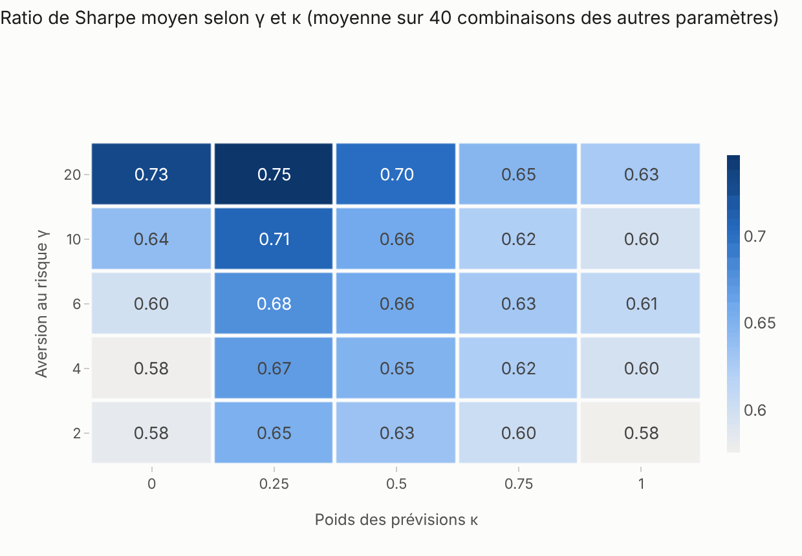

**Plafond de volatilité.** Avec γ = 6, le plafond n'est contraignant qu'en dessous de 10 % : au-delà, les résultats sont identiques. Un plafond serré améliore fortement le profil (à 4 % : Sharpe 0,75, drawdown −6,0 %, mais rendement de 4,8 % par an seulement). C'est le levier le plus direct pour adapter la stratégie à un mandat prudent.

**Poids maximal par actif.** En dessous de 30 %, la contrainte devient trop forte : à 15 %, la stratégie ne peut investir que 51 % du capital en moyenne et son Sharpe tombe à 0,50. Au-delà de 30 %, le gain est faible et la concentration augmente.

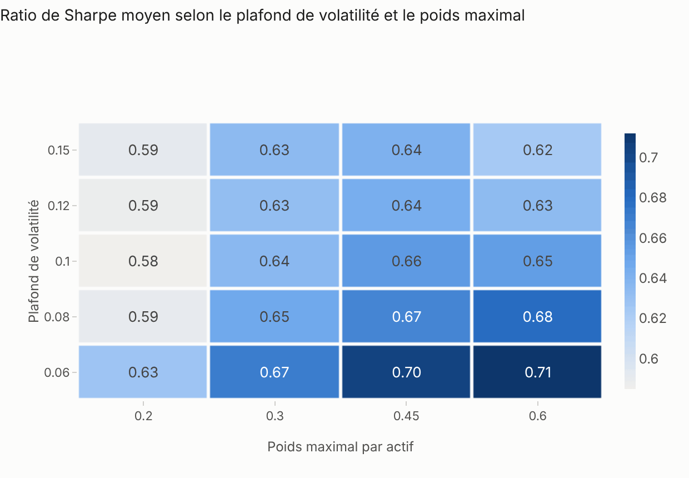

**Filtre de tendance.** C'est le seul paramètre qui change la forme du risque et pas seulement son niveau.

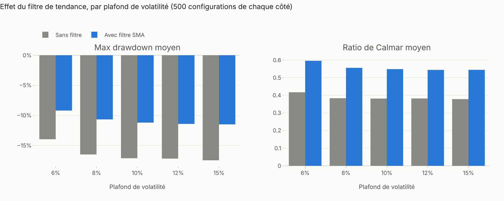

| Moyenne sur 500 configurations | Sans filtre | Avec filtre |
|---|---:|---:|
| Ratio de Sharpe | 0,64 | 0,65 |
| Drawdown maximal | −16,4 % | **−10,8 %** |
| Ratio de Calmar | 0,39 | **0,56** |
| Turnover annuel | 65 % | 120 % |

À Sharpe quasi identique, le filtre réduit le drawdown d'un tiers. Il le fait au prix d'un turnover presque doublé.

**Coûts de transaction.** Le Sharpe reste stable jusqu'à 10 bps (0,66-0,68), puis se dégrade : 0,59 à 20 bps, 0,50 à 40 bps, soit le niveau du 1/N. Comme les coûts sont dans l'objectif, l'optimiseur s'adapte en traitant moins (turnover de 209 % à 0 bps, 52 % à 40 bps). Pour des ETF très liquides, 5 à 10 bps tout compris est réaliste ; pour un particulier avec des frais de courtage fixes, la stratégie serait moins intéressante.

**Buffer.** Sans effet mesurable sur le Sharpe entre 0 et 10 % (0,65-0,67). Il réduit le turnover de 133 % à 117 % : il élimine des transactions qui étaient du bruit, sans coût de performance.

**Date de début.** C'est le paramètre le plus révélateur.

| Début | Stratégie | 60/40 | Écart |
|---|---:|---:|---:|
| 2011 | 0,66 | 0,83 | −0,17 |
| 2013 | 0,61 | 0,80 | −0,19 |
| 2015 | 0,51 | 0,68 | −0,17 |
| 2018 | 0,59 | 0,60 | −0,01 |
| 2020 | 0,61 | 0,56 | +0,05 |
| 2022 | **0,83** | 0,33 | **+0,50** |

Le Sharpe de la stratégie varie peu selon le point de départ (0,51 à 0,83) ; celui du 60/40 s'effondre de 0,83 à 0,33. La sous-performance relative s'explique entièrement par les années 2011-2017, exceptionnellement favorables au 60/40.

---

## 8. Robustesse statistique

### Le risque de timing

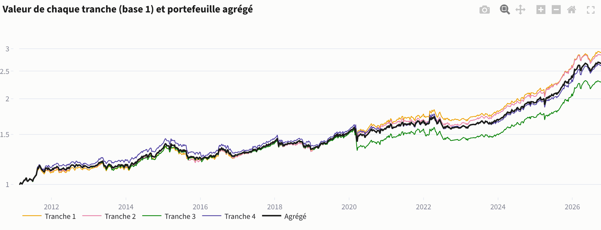

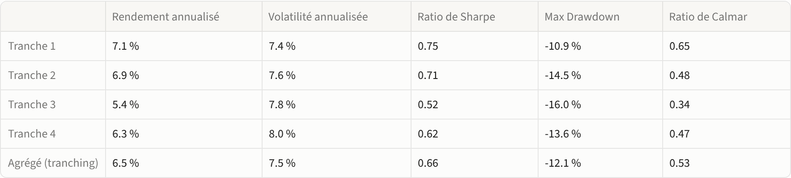

Les 4 tranches appliquent exactement la même stratégie, décalées d'une semaine. Leur Sharpe va de **0,52 à 0,75** et leur drawdown de −10,9 % à −16,0 %. Cet écart de 0,23 provient uniquement du choix de la semaine de rééquilibrage. Un backtest sur une seule tranche aurait pu afficher 0,75 ou 0,52 selon le hasard du calendrier. C'est la raison du tranching, et c'est un ordre de grandeur utile : tout effet inférieur à 0,2 de Sharpe dans ce projet doit être considéré comme non significatif.

### Intervalle de confiance du Sharpe

Bootstrap par blocs stationnaires (blocs de 13 semaines, 5 000 tirages) sur les rendements hebdomadaires :

| Différence de Sharpe | Estimation | IC à 95 % | Probabilité d'être positive |
|---|---:|---:|---:|
| Stratégie − 60/40 | −0,16 | [−0,63 ; +0,23] | 18 % |
| Stratégie − 1/N | +0,15 | [−0,25 ; +0,48] | 73 % |

Aucune des deux différences n'est statistiquement significative. Sur 15 ans, le test n'a pas la puissance de distinguer un écart de Sharpe de 0,15 : il faudrait plusieurs décennies de données. Le t-stat du Sharpe de la stratégie elle-même (Lo, 2002) est de 2,63 : sa performance absolue est, elle, significativement positive.

### Queue de distribution

| Hebdomadaire | Stratégie | 60/40 | 1/N |
|---|---:|---:|---:|
| VaR 95 % | −1,75 % | −1,94 % | −2,02 % |
| CVaR 95 % | −2,50 % | −3,00 % | −3,12 % |
| Pire semaine | −7,7 % (13/03/2020) | −7,7 % | −9,2 % |
| Asymétrie (skewness) | −0,67 | −0,34 | −0,54 |
| Excès de kurtosis | 6,0 | 4,7 | 6,6 |

La stratégie réduit la VaR et la CVaR, mais pas le pire choc hebdomadaire. Sa distribution est même plus asymétrique à gauche que celle du 60/40 : un filtre de tendance coupe les baisses prolongées, pas les krachs soudains. La semaine du 13 mars 2020 l'illustre : le portefeuille était encore investi quand le choc est arrivé.

### Sur-apprentissage et tests multiples

1 054 backtests ont été réalisés pour ce README. Le meilleur Sharpe de la grille (0,82, sans filtre de tendance, κ = 0,25, plafond de 6 %) est mécaniquement biaisé à la hausse par la sélection. C'est pourquoi le README présente la configuration fixée a priori et la distribution complète, jamais le meilleur résultat. Les hyper-paramètres des modèles (ARIMA, GARCH, XGBoost) ont été fixés à partir de la littérature et ne sont pas optimisés sur la période de backtest.

---

## 9. Enseignements pour la gestion quantitative

1. **La prévision de rendement est le maillon faible, la prévision de risque le maillon fort.** Les rendements à un mois sont quasi imprévisibles, la volatilité l'est nettement. Une stratégie robuste s'appuie d'abord sur ce qui est prévisible.
2. **Le machine learning n'invente pas de signal.** XGBoost, correctement régularisé et calibré hors échantillon, s'éteint de lui-même quand il n'y a rien à apprendre. Sans ce garde-fou, il aurait produit un bon backtest et un mauvais portefeuille.
3. **Le rétrécissement des espérances est indispensable.** La forme en cloche du Sharpe en fonction de κ et sa hausse avec γ montrent que l'optimiseur amplifie les erreurs des prévisions. Un prior neutre et un poids faible sur les vues sont plus efficaces qu'un modèle plus complexe.
4. **Un filtre de tendance est un outil de gestion du risque, pas de prévision.** Il ne détecte pas les bons rendements, il détecte les régimes de forte volatilité. Il améliore le Calmar, pas forcément le Sharpe.
5. **Le benchmark et la période font le résultat.** Le même portefeuille perd 0,17 de Sharpe contre le 60/40 depuis 2011 et en gagne 0,50 depuis 2022. Présenter une seule fenêtre revient à choisir sa conclusion.
6. **Le timing luck est du même ordre que l'alpha recherché.** 0,23 de Sharpe d'écart entre des tranches identiques : sans tranching, la moitié des conclusions d'un backtest de ce type peut être un artefact de calendrier.
7. **La robustesse se mesure sur une distribution, pas sur un point.** 95 % des configurations réduisent le drawdown par rapport au 60/40 : c'est la conclusion la plus solide du projet, plus solide que n'importe quel Sharpe isolé.

---

## 10. Limites et pistes

**Limites**

- **La crise de 2008 n'est pas dans le backtest.** L'historique commence en 2006 (DBC) et la première estimation demande 5 ans : la stratégie n'a jamais été testée sur une crise financière systémique prolongée.
- **Échantillon court pour l'inférence.** 817 semaines, moins de 200 périodes de 4 semaines indépendantes : les différences de Sharpe ne sont pas statistiquement significatives.
- **Retard structurel du filtre de tendance.** Il protège contre les baisses prolongées, pas contre les krachs soudains, et génère des faux signaux en marché sans direction (2015-2019).
- **Biais de sélection de l'univers.** Les ETF ont été choisis en connaissant leur historique.
- **Modèle de coûts simplifié.** Coût linéaire constant, pas d'élargissement des spreads en période de stress, pas de fiscalité.
- **Investissabilité pour un épargnant européen.** Les ETF américains ne sont pas accessibles aux particuliers de l'UE (PRIIPs). Une mise en œuvre réelle passerait par des équivalents UCITS, avec un risque de change EUR/USD non modélisé ici.
- **Hypothèses de modèle.** Utilité moyenne-variance (gaussienne conditionnelle), GARCH symétrique pour tous les actifs, ARMA linéaire.

**Pistes**

- Allonger l'historique avec des indices de substitution avant 2006 pour couvrir 2000-2002 et 2008.
- Remplacer la prévision de rendement par un signal de momentum transversal ou de carry, mieux documentés.
- Ajouter un benchmark de parité de risque et un 60/40 à volatilité cible.
- Version UCITS en euros avec couverture de change.
- Ratio de Sharpe déflaté (Bailey & López de Prado) sur l'ensemble des essais.
- GJR-GARCH pour les actifs actions, où l'asymétrie est significative.

---

## 11. Reproduire les résultats

```bash
git clone https://github.com/Anto279/strat-invest-direct.git
cd strat-invest-direct
python -m venv .venv && source .venv/bin/activate
pip install -r requirements.txt

python -m scripts.run_research          # données, signaux walk-forward (mis en cache), backtest, rapport
streamlit run app.py                    # interface
python -m scripts.parameter_sweep       # analyse de sensibilité (1 054 backtests, environ 35 min sur 4 cœurs)
pytest -q                               # tests des invariants méthodologiques
```

Le premier calcul des signaux ré-estime chaque semaine ARIMA, GARCH et XGBoost pour chaque actif. Il prend 5 à 15 minutes, parallélisé par actif, puis il est mis en cache dans `data/cache/`. Tous les paramètres de portefeuille et d'exécution sont ensuite ré-évalués en quelques secondes depuis la barre latérale.

Les chiffres de ce README correspondent aux données extraites le 9 octobre 2026. Une nouvelle extraction allonge l'échantillon et modifie légèrement les résultats.

### L'application

| Onglet | Contenu |
|---|---|
| **Univers & diversification** | Statistiques descriptives, benchmarks, performances et volatilités glissantes, corrélations ordonnées par clustering, dendrogramme, nombre effectif de paris, corrélations glissantes |
| **Recherche & preuves statistiques** | ARIMA (ADF/KPSS, ACF/PACF, grilles BIC/AICc, diagnostics, prévisions hors échantillon) · XGBoost (variables, SHAP, validation Diebold-Mariano) · GARCH (spécifications, tests, évaluation sur le test) · Markowitz et tendance (frontière, bornes SMA, tests conditionnels, ablation) · Exécution (tranches, turnover, sensibilité coûts × buffer) |
| **Backtest & performance** | Indicateurs vs benchmark, valeur du portefeuille, drawdown, tableau de performance, allocation, rendements annuels, Sharpe glissant, export CSV |

### Structure du dépôt

```
app.py                      Point d'entrée Streamlit
src/
  config.py                 Univers, benchmarks, hyper-paramètres (dataclasses immuables, hachées)
  data.py                   Téléchargement, barres hebdomadaires, taux sans risque, cache Parquet
  features.py               Variables causales et stationnaires
  trend.py                  Score de tendance SMA, tests conditionnels
  models/arima.py           Stationnarité, sélection d'ordre, diagnostics
  models/hybrid.py          XGBoost sur résidus, calibration purgée, SHAP
  models/garch.py           Spécifications GARCH, évaluation hors échantillon
  stats_tests.py            Diebold-Mariano, R² hors échantillon, Mincer-Zarnowitz, IC
  signals.py                Génération walk-forward parallèle des signaux
  portfolio.py              Optimiseur moyenne-variance contraint, frontière efficiente
  backtest.py               Moteur hebdomadaire : tranches, coûts, buffer, décalage d'exécution
  metrics.py                Mesures de performance
  analytics.py              Statistiques descriptives, clustering, diversification
  pipeline.py               Orchestration, ablation, sensibilité
  ui.py, views/             Thème graphique et onglets
scripts/
  run_research.py           Pipeline complète en ligne de commande
  parameter_sweep.py        Analyse de sensibilité
tests/                      Tests unitaires (données synthétiques)
docs/
  results/                  Résultats de l'analyse de sensibilité
  journal_methodologique.md Corrections apportées par rapport à la première version
```

---

## 12. Glossaire

| Terme | Définition |
|---|---|
| **Walk-forward** | Méthode de backtest où chaque décision n'utilise que les données disponibles à sa date. Les modèles sont ré-estimés au fil du temps, comme ils l'auraient été en production. |
| **Ratio de Sharpe** | Rendement en excès du taux sans risque divisé par la volatilité. Mesure le rendement obtenu par unité de risque. |
| **Drawdown maximal** | Plus forte baisse entre un sommet et un creux. C'est la pire perte qu'aurait subie un investisseur entré au plus mauvais moment. |
| **Ratio de Calmar** | Rendement annualisé divisé par le drawdown maximal. Mesure le rendement obtenu par unité de perte extrême. |
| **VaR / CVaR 95 %** | Perte hebdomadaire dépassée 5 % du temps / perte moyenne au-delà de ce seuil. |
| **R² hors échantillon** | Réduction de l'erreur de prévision par rapport à une prévision naïve (la moyenne historique). Négatif : le modèle fait moins bien que la moyenne. |
| **Coefficient d'information (IC)** | Corrélation de rang entre prévisions et réalisations. En gestion, un IC de 0,03 à 0,05 est déjà exploitable. |
| **Test de Diebold-Mariano** | Test statistique qui compare l'erreur de deux modèles de prévision. |
| **ARIMA / ARMA** | Modèle qui prévoit une série à partir de ses valeurs et de ses erreurs passées. |
| **GARCH** | Modèle où la volatilité d'aujourd'hui dépend des chocs et de la volatilité d'hier. Capture le regroupement des périodes de stress. |
| **XGBoost** | Algorithme d'apprentissage qui combine de nombreux arbres de décision peu profonds. |
| **SHAP** | Méthode qui décompose une prédiction en contributions de chaque variable. |
| **Ledoit-Wolf** | Estimateur qui rétrécit la matrice de corrélation empirique vers une cible simple pour réduire le bruit d'estimation. |
| **Prior / rétrécissement** | Valeur neutre vers laquelle on tire des estimations bruitées. Plus κ est faible, plus on fait confiance au prior. |
| **Turnover** | Part du portefeuille échangée sur une période. 129 % par an signifie que le portefeuille est renouvelé environ 1,3 fois par an. |
| **Tranching** | Découpage du capital en sous-portefeuilles rééquilibrés à des dates décalées, pour neutraliser l'effet du calendrier. |
| **Bootstrap par blocs** | Ré-échantillonnage de blocs de rendements consécutifs pour estimer l'incertitude d'une statistique sans hypothèse de loi. |

---

## 13. Références

- Bailey, D., López de Prado, M. (2014). The Deflated Sharpe Ratio. *Journal of Portfolio Management*.
- Black, F., Litterman, R. (1992). Global Portfolio Optimization. *Financial Analysts Journal*.
- Bollerslev, T. (1986). Generalized Autoregressive Conditional Heteroskedasticity. *Journal of Econometrics*.
- Campbell, J., Thompson, S. (2008). Predicting Excess Stock Returns Out of Sample. *Review of Financial Studies*.
- Chen, T., Guestrin, C. (2016). XGBoost: A Scalable Tree Boosting System. *KDD*.
- DeMiguel, V., Garlappi, L., Uppal, R. (2009). Optimal Versus Naive Diversification. *Review of Financial Studies*.
- Diebold, F., Mariano, R. (1995). Comparing Predictive Accuracy. *Journal of Business & Economic Statistics*.
- Faber, M. (2007). A Quantitative Approach to Tactical Asset Allocation. *Journal of Wealth Management*.
- Grinold, R., Kahn, R. (2000). *Active Portfolio Management*. McGraw-Hill.
- Harvey, D., Leybourne, S., Newbold, P. (1997). Testing the Equality of Prediction Mean Squared Errors. *International Journal of Forecasting*.
- Hoffstein, C., Faber, N., Braun, S. (2020). Rebalance Timing Luck. *Journal of Index Investing*.
- Hurst, B., Ooi, Y., Pedersen, L. (2017). A Century of Evidence on Trend-Following Investing. *Journal of Portfolio Management*.
- Ledoit, O., Wolf, M. (2004). A Well-Conditioned Estimator for Large-Dimensional Covariance Matrices. *Journal of Multivariate Analysis*.
- Lo, A. (2002). The Statistics of Sharpe Ratios. *Financial Analysts Journal*.
- López de Prado, M. (2018). *Advances in Financial Machine Learning*. Wiley.
- Lundberg, S., Lee, S.-I. (2017). A Unified Approach to Interpreting Model Predictions. *NeurIPS*.
- Markowitz, H. (1952). Portfolio Selection. *Journal of Finance*.
- Michaud, R. (1989). The Markowitz Optimization Enigma: Is 'Optimized' Optimal? *Financial Analysts Journal*.
- Moskowitz, T., Ooi, Y., Pedersen, L. (2012). Time Series Momentum. *Journal of Financial Economics*.
- Patton, A. (2011). Volatility Forecast Comparison Using Imperfect Volatility Proxies. *Journal of Econometrics*.
- Politis, D., Romano, J. (1994). The Stationary Bootstrap. *Journal of the American Statistical Association*.
- Roy, A. D. (1952). Safety First and the Holding of Assets. *Econometrica*.
- Welch, I., Goyal, A. (2008). A Comprehensive Look at the Empirical Performance of Equity Premium Prediction. *Review of Financial Studies*.
- Zhang, G. P. (2003). Time Series Forecasting Using a Hybrid ARIMA and Neural Network Model. *Neurocomputing*.

---

*Projet de recherche. Ne constitue pas un conseil en investissement. Les performances passées, a fortiori simulées, ne préjugent pas des performances futures.*
